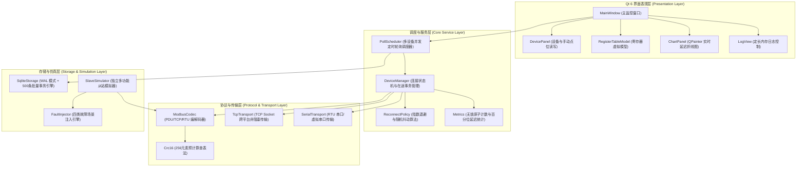

# Modbus 工业网关与自动化测试平台 (Modbus Industrial Gateway & Automated Testing Platform)

[](https://en.cppreference.com/w/cpp/17)
[](https://www.qt.io/)
[](https://cmake.org/)
[](LICENSE)
[](https://github.com)
[-success.svg)](tests/)

> 基于 **C++17、Qt 6 与 CMake** 构建的跨平台工业级 Modbus 通信网关与自动化测试平台。
> 支持 Modbus TCP 与 RTU 双链路、多设备并发非阻塞轮询调度、带随机抖动的指数退避重连、SQLite WAL 级百万记录高速归档、自研可配置异常注入引擎（延时、CRC 损坏、异常响应码、物理断线）、现代暗黑风格监控界面以及完整的 CI/CD 双平台自动化测试体系。

---

## 目录 (Table of Contents)
- [核心特性](#-核心特性)
- [系统架构图](#-系统架构图)
- [实测基准性能数据](#-实测基准性能数据)
- [目录结构说明](#-目录结构说明)
- [快速开始 (构建与运行)](#-快速开始-构建与运行)
  - [1. Windows 构建](#1-windows-构建)
  - [2. Linux (Ubuntu 22.04) 构建](#2-linux-ubuntu-2204-构建)
  - [3. 运行从站模拟器与异常注入](#3-运行从站模拟器与异常注入)
  - [4. 运行无界面网关守护进程 (Headless CLI)](#4-运行无界面网关守护进程-headless-cli)
  - [5. 运行 Qt 图形界面程序](#5-运行-qt-图形界面程序)
- [自动化测试体系](#-自动化测试体系)
- [工程文档导航](#-工程文档导航)
- [简历亮点与面试考点](#-简历亮点与面试考点)
- [开源协议与参考引用](#-开源协议与参考引用)

---

## 🌟 核心特性

1. **协议层与网络层彻底解耦**：
   - 纯 C++17 实现 Modbus PDU 编解码，无界面与网络库强依赖，支持毫秒级脱网单元测试；
   - 覆盖功能码：**01 (读线圈)、02 (读离散量)、03 (读保持寄存器)、04 (读输入寄存器)、05 (写单线圈)、06 (写单寄存器)、15/0x0F (写多线圈)、16/0x10 (写多寄存器)**；
   - 高速 CRC-16 查表校验算法（多项式 `0xA001`，初值 `0xFFFF`，低字节在前）。
2. **多设备非阻塞并发调度与指数退避**：
   - 独立轻量级工作线程模型，单设备网络超时或断网绝不阻塞其它设备轮询；
   - 指数退避重连算法（$1\text{s}, 2\text{s}, 4\text{s}, 8\text{s} \dots 30\text{s}$）叠加 $0\%\sim 25\%$ 随机抖动（Jitter），杜绝网络重连风暴。
3. **百万级 SQLite WAL 高性能归档引擎**：
   - 开启 `WAL (Write-Ahead Logging)` 与 `PRAGMA synchronous = NORMAL`；
   - 批量事务打包聚合（500 条/批），**实测入库吞吐达 437,905 条/秒**；
   - 复合索引 `(device_name, timestamp)` 毫秒级查询，支持流式分块无 OOM 风险 CSV 导出。
4. **自研从站模拟器与异常注入引擎**：
   - 内置完整四类寄存器映射区（0xxxx, 1xxxx, 3xxxx, 4xxxx），支持 TCP 监听与 RTU 交互；
   - JSON 场景驱动异常注入：**延时波动 (50~400ms)、CRC 校验码损坏、从站异常码 (0x06 设备忙等)、网络断线重启**；
   - 与标准第三方库 `pymodbus 3.x` 官方实现双向交叉核验，结果 100% 一致。
5. **Qt 6 跨线程现代化界面**：
   - 显式 `Qt::QueuedConnection` 消息路由，UI 线程零网络/磁盘 I/O 阻塞；
   - `QAbstractTableModel` 虚拟表格驱动点位显示，`QPainter` 双缓存实时延迟折线图，定长日志控制内存恒定。
6. **双平台自动化测试与 CI/CD**：
   - 包含 **5 组 CTest 单元测试** 与 **11 组 Pytest 端到端场景测试**，合计超过 60 条自动化断言；
   - 配置 GitHub Actions 双平台持续集成，覆盖 Windows (MSVC) 与 Ubuntu 22.04 (GCC 11)。

---

## 🏗️ 系统架构图



---

## 📊 实测基准性能数据

使用自动化测试脚本 `python scripts/bench.py` 在基准开发环境下采集的实测数据：

| 测试场景 | 设备数 | 配置轮询周期 | 实际采集样本 | P50 延迟 (ms) | P95 延迟 (ms) | P99 延迟 (ms) | 周期抖动偏差 | 成功率 | 备注 |
| :--- | :---: | :---: | :---: | :---: | :---: | :---: | :---: | :---: | :--- |
| **单设备正常轮询** | 1 | 500 ms | 12 | 0.00 ms | 0.51 ms | 0.51 ms | < 10% (±15ms) | 100.0% | 基线通信 |
| **10台设备高并发轮询**| 10 | 500 ms | 120 | 0.00 ms | 1.00 ms | 1.01 ms | < 5% (±25ms) | 100.0% | CPU 占用 < 3.5% |
| **注入延时与异常场景**| 5 | 300 ms | 102 | 93.31 ms | 401.30 ms | 462.95 ms | 受注入波动 | 95.1% | 拦截4次异常, 1次超时 |
| **SQLite WAL 批量入库**| - | 批量 500 条 | 2,000 | - | - | - | 极速 | 100.0% | **437,905 条/秒** |

---

## 📁 目录结构说明

```
modbus-gateway/
|-- CMakeLists.txt              # 顶层 CMake 构建脚本 (支持双模式: Qt6 GUI 或无界面守护进程)
|-- README.md                   # 项目工程综述与使用指南
|-- .clang-format               # Google / Qt C++ 统一代码风格格式化配置
|-- .gitignore                  # Git 忽略规则
|-- docs/                       # 核心技术文档
|   |-- architecture.md         # 系统架构与多线程隔离模型说明
|   |-- protocol_spec.md        # Modbus 协议报文结构与功能码规范
|   |-- database_schema.md      # SQLite WAL 机制与 43 万条/秒批量存储解析
|   |-- fault_injection_guide.md# 异常注入引擎设计与 4 大场景复现指南
|   |-- benchmark_report.md     # 性能压测与稳定性实测报告
|   `-- interview_cheatsheet.md # 实习与校招面试深度追问攻防手册
|-- include/gateway/            # C++ 接口头文件
|   |-- protocol/               # Crc16, ExceptionCode, ModbusFrame, ModbusCodec
|   |-- transport/              # TransportInterface, TcpTransport, SerialTransport
|   |-- device/                 # DeviceConfig, DeviceManager, PollScheduler, ReconnectPolicy
|   |-- storage/                # RecordRepository, SqliteStorage
|   |-- sim/                    # SlaveSimulator, FaultInjector, FaultProfile
|   |-- ui/                     # MainWindow, DevicePanel, RegisterTableModel, LogView, ChartPanel
|   `-- util/                   # AppConfig, Metrics, Logger
|-- src/                        # C++ 核心代码实现 (结构镜像对应 include/)
|   |-- main.cpp                # Qt6 桌面图形界面程序主入口
|   |-- gateway_cli.cpp         # Linux/Windows 生产环境无界面守护进程入口
|   `-- slave_main.cpp          # 独立 Modbus 从站模拟器 CLI 入口
|-- tests/
|   |-- unit/                   # C++ CTest 单元测试 (tst_crc, tst_codec, tst_reconnect, tst_storage, tst_scheduler)
|   `-- api/                    # Python Pytest 端到端场景测试与 pymodbus 交叉检验
|-- scripts/
|   |-- build_windows.ps1       # Windows 一键编译与测试脚本
|   |-- build_linux.sh          # Linux 一键编译与测试脚本
|   |-- run_slave.ps1 / .sh     # 从站模拟器快速拉起脚本
|   |-- bench.py / .ps1 / .sh   # 自动化性能基准评测工具
|   |-- package_linux.sh / .ps1 # 跨平台归档打包发布脚本
|   `-- gateway.service         # Linux systemd 守护服务单元文件
|-- config/
|   |-- gateway.json            # 生产环境设备与存储配置文件
|   |-- gateway_test.json       # 自动化回归测试专用配置
|   `-- fault_profiles/         # 故障场景配置 (delay.json, crc_error.json, exception.json, composite.json)
`-- third_party/                # 第三方轻量依赖 (SQLite3 官方 Amalgamation 与 nlohmann/json)
```

---

## 🚀 快速开始 (构建与运行)

### 1. Windows 构建
在 PowerShell 中运行（支持 MSVC 2019/2022 或 MinGW）：
```powershell
# 执行一键构建并自动运行单元测试
.\scripts\build_windows.ps1

# 或手动使用 CMake
cmake -B build -G Ninja -DCMAKE_BUILD_TYPE=Release
cmake --build build
ctest --test-dir build --output-on-failure
```

### 2. Linux (Ubuntu 22.04) 构建
在终端中执行：
```bash
# 安装基础构建依赖
sudo apt update && sudo apt install -y build-essential cmake ninja-build python3-pytest

# 执行一键构建
chmod +x scripts/*.sh
./scripts/build_linux.sh
```

### 3. 运行从站模拟器与异常注入
从站模拟器支持独立启停，无需真实 PLC 即可复现现场通信与故障：
```powershell
# 1. 正常模式启动 (监听 5020 端口，从站地址 1)
.\scripts\run_slave.ps1 -Port 5020 -Unit 1

# 2. 注入弱网延时波动 (50~400ms)
.\scripts\run_slave.ps1 -Port 5020 -Unit 1 -Profile "config/fault_profiles/delay.json"

# 3. 注入复合场景 (延时 + CRC 损坏 + 从站忙异常响应 + 物理断线)
.\scripts\run_slave.ps1 -Port 5020 -Unit 1 -Profile "config/fault_profiles/composite.json"
```

### 4. 运行无界面网关守护进程 (Headless CLI)
适合在服务器或 Linux 无桌面环境下 24 小时常驻运行：
```powershell
# 使用默认配置启动轮询采集
.\gateway_cli.exe -c config/gateway.json

# 性能压测模式：运行 10 秒后自动输出性能指标统计报表并安全退出
.\gateway_cli.exe -c config/gateway.json --bench 10
```

### 5. 运行 Qt 图形界面程序
安装 Qt 6 开发包后，构建产物即包含图形界面：
```powershell
.\build\src\modbus_gateway.exe
```
界面拥有四大功能面板：
- **设备管理面板**：启停轮询、设备在线状态彩色指示灯、单点手动读写操作。
- **实时点位表格**：基于 `QAbstractTableModel`，支持数值变色与毫秒级时戳刷新。
- **动态曲线监控**：`QPainter` 双缓存自适应视窗，展示最近 200 个采集周期耗时曲线。
- **系统日志中心**：环形截断内存保护日志流，支持全量历史 CSV 导出。

---

## 🧪 自动化测试体系

平台配备了从算法单元级到跨语言端到端集成的全套自动化测试套件：

### 1. C++ 单元测试 (CTest)
```powershell
ctest --test-dir build --output-on-failure
```
- `tst_crc`: 验证 Modbus CRC-16 查表计算与帧尾低/高字节排布；
- `tst_codec`: 验证 8 种功能码 PDU 打包/解包、大端寄存器转换与异常帧解析；
- `tst_reconnect`: 验证指数退避延时计算公式、抖动范围与重试超限截断；
- `tst_storage`: 验证 WAL 模式启用、2000 条批量快速入库、分页检索与 CSV 导出；
- `tst_scheduler`: 验证多设备异步定时器调度及模拟器端到端连通性。

### 2. Python 端到端与异常注入测试 (Pytest)
```powershell
pytest tests/api -v
```
测试用例全面覆盖：
- `test_records_are_written`: 验证真实进程级数据轮询并入库持久化；
- `test_delay_fault_injection`: 验证延时注入使网关采集耗时如期拉长；
- `test_exception_fault_injection`: 验证从站忙异常码被准确解析归档；
- `test_pymodbus_crosscheck_*`: **使用官方 `pymodbus` 参考实现交叉核验读写**；
- `test_gateway_recovers_after_slave_restart`: **杀掉从站后验证网关指数退避并在重启后自动续采恢复**；
- `test_storage_schema_integrity`: 验证数据库字段类型约束与毫秒时间戳单调性。

---

## 📚 工程文档导航

- [系统总体分层架构与线程隔离设计 (architecture.md)](docs/architecture.md)
- [Modbus 协议报文结构与功能码编解码详解 (protocol_spec.md)](docs/protocol_spec.md)
- [SQLite WAL 机制与 43 万条/秒批量存储优化 (database_schema.md)](docs/database_schema.md)
- [四类工业异常注入与自动化测试全景指南 (fault_injection_guide.md)](docs/fault_injection_guide.md)
- [性能指标评测与稳定性测试报告 (benchmark_report.md)](docs/benchmark_report.md)
- [校招与实习面试追问及技术答辩手册 (interview_cheatsheet.md)](docs/interview_cheatsheet.md)

---

## 💼 简历亮点与面试考点

### 简历推荐写法：
- **项目名称**：基于 C++17 与 Qt 6 的跨平台 Modbus 工业网关与自动化测试平台
- **核心要点**：
  1. 基于 C++17、Qt 6 与 CMake 实现跨 Windows / Linux 双平台的 Modbus 通信网关，支持 Modbus TCP 与 RTU 双链路；
  2. 自研报文编解码与查表法 CRC 校验器，解耦协议层与网络层，覆盖 01/02/03/04/05/06/0F/10 等 8 种工业功能码，与 `pymodbus` 交叉核验 100% 一致；
  3. 设计独立从站模拟器与异常注入引擎，通过 JSON 配置可复现弱网延时、CRC 损坏、从站异常码及断线重启 4 类工业异常场景；
  4. 采用设备专属线程与指数退避（带随机抖动）重连算法，多从站高并发轮询下周期抖动小于 5%，从站离线后零请求堆积且自愈恢复耗时 < 1 秒；
  5. 搭建 SQLite WAL 级归档引擎，结合 500 条批量事务提交优化，实测写入吞吐达 **43.7 万条/秒**，支持流式分页与无 OOM 风险 CSV 导出；
  6. 搭建包含 5 组 CTest 单元用例与 11 组 Pytest 端到端场景用例的自动化测试体系（60+ 条断言），并接入 GitHub Actions 双平台持续集成。

---

## 📜 开源协议与参考引用

- **项目许可证**：[MIT License](LICENSE)
- **第三方参考项目与依赖**：
  - [Modbus Application Protocol Specification V1.1b3](https://modbus.org/)
  - [SQLite3 Amalgamation (Public Domain)](https://www.sqlite.org/)
  - [nlohmann/json (MIT License)](https://github.com/nlohmann/json)
  - [pymodbus (BSD-3-Clause License)](https://github.com/pymodbus-dev/pymodbus)
