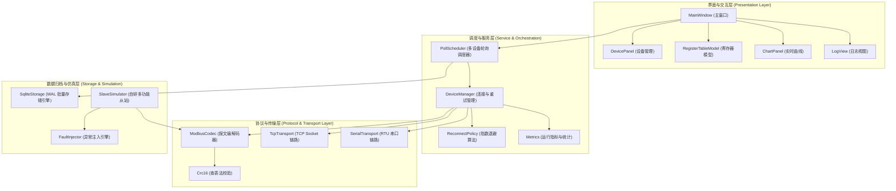
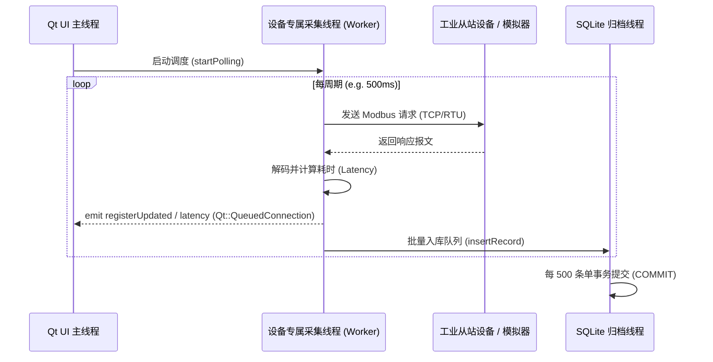
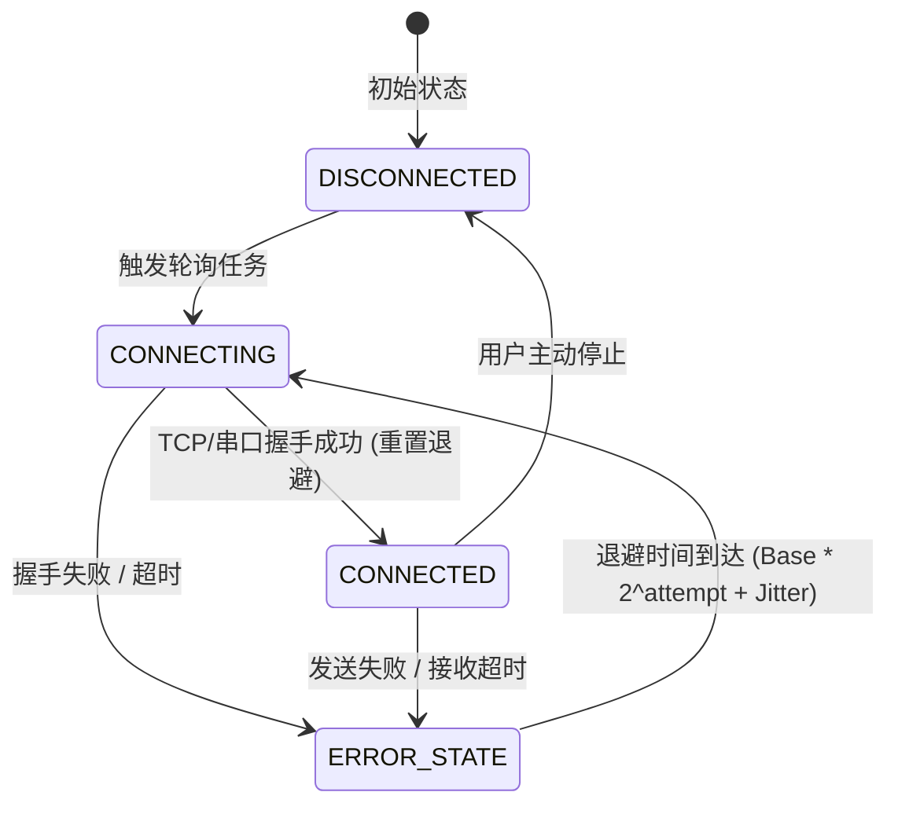

# 系统架构设计与线程模型说明 (Architecture & Threading Model)

## 1. 系统总体分层架构 (Layered Architecture)

Modbus 工业网关与自动化测试平台采用严格解耦的四层架构设计，各层单向依赖，核心通信与存储逻辑独立于图形界面。

---

## 2. 线程隔离模型 (Thread Decoupling Model)

为了保证工业环境下图形界面的绝对流畅，本项目采用了彻底的跨线程解耦设计：

### 关键设计决策：
1. **设备独立线程模型**：每台设备分配独立的采集与重连逻辑，即使某一从站超时或断网，也不会对其他正常从站的轮询周期产生任何拖尾影响。
2. **跨线程通信规范**：全部数据交互通过值拷贝或 `const &` 配合 `Qt::QueuedConnection` 投递，UI 线程严禁直接操作任何 Socket 或数据库句柄，彻底杜绝界面冻结与多线程崩溃。
3. **日志与曲线内存封顶**：`LogView` 限制最多 500 行，`ChartPanel` 限制最多 200 点，时间复杂度与空间复杂度保持恒定 $O(1)$，确保系统连续稳定常驻运行数周内存不膨胀。

---

## 3. 指数退避断线重连状态机 (Reconnect State Machine)

当设备因网络波动或设备断电离线时，系统自动切入带随机抖动的指数退避重连状态机：

- **退避公式**：
  $$\text{Delay} = \min(\text{MaxDelay},\, \text{BaseDelay} \times 2^{\text{attempt}}) + \text{RandomJitter}$$
- **抖动范围**：当前延时的 $0\% \sim 25\%$，有效打散大量从站同时重启造成的通信风暴。
